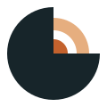

```{raw} html
<div class="ore-hero">
  
</div>
```

# Open Resources for Earth Sciences

```{raw} html
<p class="ore-tagline"> Open resources · Community built · Earth Sciences </p>
```

**ore** is a community project that aims to educate compulational literacy amongst earth scientists.

:::{admonition} Next workshop: Introduction to Python for Geoscientists
:class: tip

[DD] To be updated · 16:00 IST · Online and Everywhere · Instructor: [ ]

[Workshop details](workshops/2026-10-ore-deposit-models.md) · [Register](https://forms.gle/your-form-link)
:::


## Our Motivation

**Computational** literacy is an essential skill for the Earth scientists. 


This initiative aims to make computational skills accessible to the Earth Science community through **small-group, hands-on online workshops** designed specifically for learners in the field.

## Worhshop plan

Each workshop is limited to a **maximum of 7 participants**, creating a supportive learning environment where everyone gets the opportunity to engage, ask questions, and develop practical programming skills.


## Refundable workshop

To encourage commitment and ensure participation, a small payment is required when registering for a workshop. **Complete all the workshop modules, and your participation fee will be refunded in full (100%).**

The initiative is not not for making profitable business. It is about building a community of Earth Science learners, sharing knowledge, and helping more people develop the computational skills.


<!----
## Browse resources

::::{grid} 1 2 2 4
:gutter: 3

:::{grid-item-card} Python for Earth Scientists
:link: modules/python-geoscience/index
:link-type: doc
Basic programming with python, numpy, matplotlib
:::


::::

--->
## Contributing

Found a great open resource, or want to teach a session? Read the
[contributing guide](community/contributing.md). You can also
[suggest a resource](https://github.com/openresearth/openresearth.github.io/issues/new?template=suggest-resource.md)
or [propose a workshop](https://github.com/openresearth/openresearth.github.io/issues/new?template=propose-workshop.md)
without editing any files.

## Contact

ore is run by [organisers]. Email: [email address]

## License

Content on this site is licensed under [CC BY 4.0](community/license.md).

```{toctree}
:hidden:
:caption: Getting Started

getting-started/about
getting-started/join
```

```{toctree}
:hidden:
:caption: Workshops

workshops/index
```
<!----
```{toctree}
:hidden:
:caption: Learning Modules

modules/python-geoscience/index
```
--->

<!-- Resources section of the sidebar, switched off for now.
   To switch it on, delete this line and the closing arrow line below it.
```{toctree}
:hidden:
:caption: Resources

resources/index
resources/ore-geology
resources/petrology-mineralogy
resources/geochemistry
resources/structural-geology
resources/geophysics
resources/remote-sensing-gis
resources/datasets
resources/software
```
-->

```{toctree}
:hidden:
:caption: Community

tutorials/index
community/contributing
community/license
```
